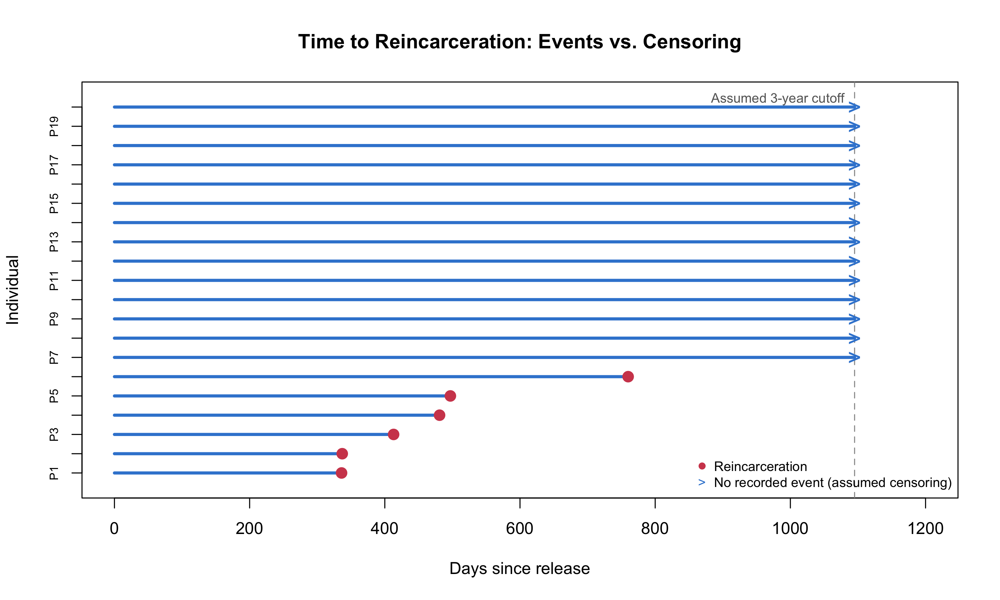
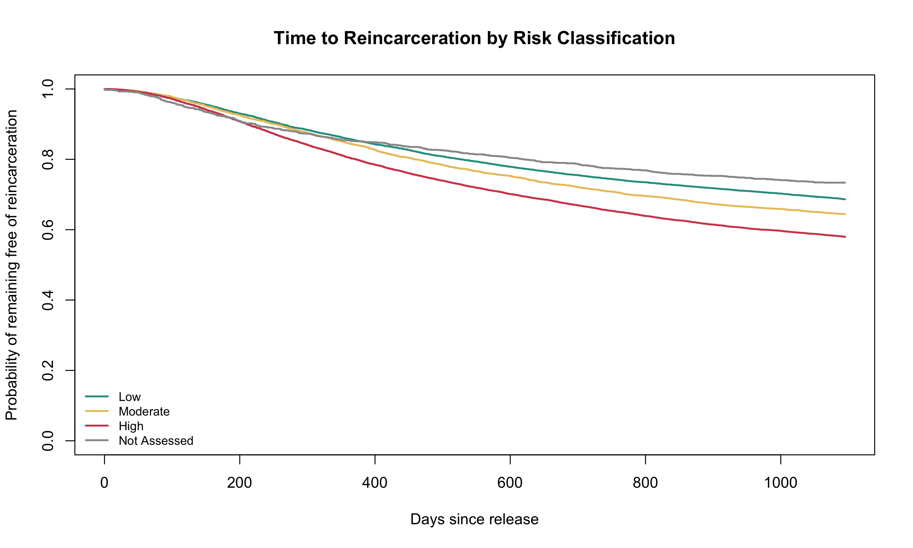
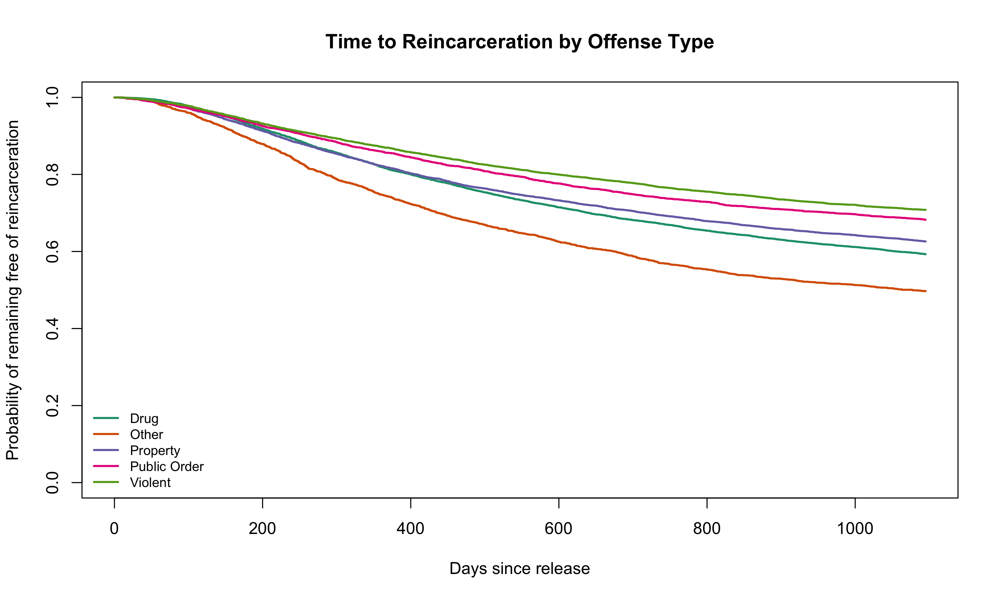
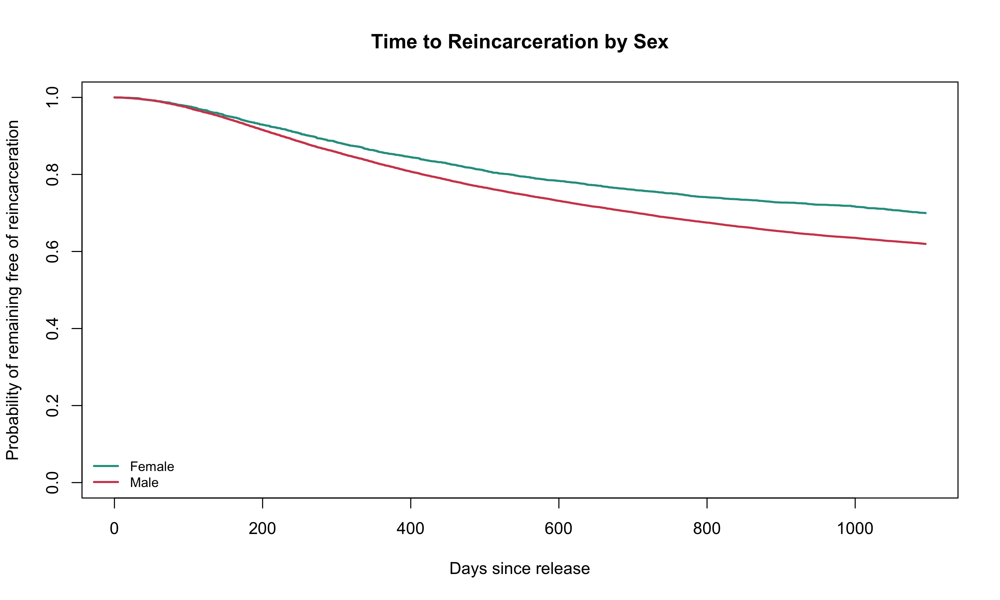
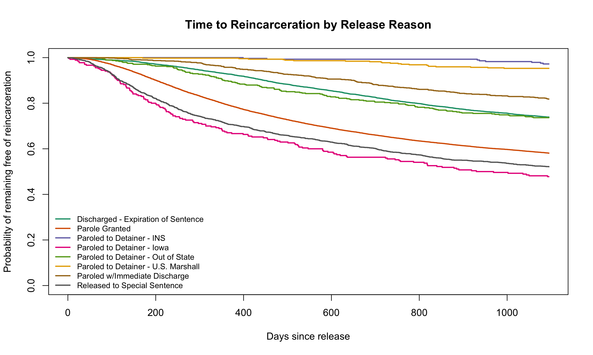

Slides: [slides.html](slides.html){target="_blank"}

## Introduction

In many studies, the outcome of interest is not only whether an event
occurs, but also how long it takes for that event to happen. For
example, researchers may be interested in how long a patient survives
after treatment, when a borrower defaults on a loan, or when a user
leaves a website. Survival analysis considers both whether an event
occurs and the time until it occurs, while accounting for censored
observations.

The Cox proportional hazards model is one of the most commonly used
methods for analyzing time-to-event data. The model allows researchers
to examine how different variables are related to the risk of
experiencing an event over time. Because of this, Cox regression can be
applied to many different types of research questions. Previous studies
have used Cox models to examine the duration of the birth process
[@wuryandari2018], the time until farmers are willing to pay
agricultural insurance premiums [@hidayat2022], website drop-offs
[@soobramoney2023], credit default [@dirick2017], and survival following
cancer treatments [@abadi2014]. Although these studies focus on very
different outcomes, they all use the same general idea of examining the
time until a specific event occurs.

An important part of using the Cox model is the proportional hazards
assumption. This assumption means that the effect of a predictor on the
hazard is expected to remain proportional over time. For example, if one
group has a higher risk of experiencing an event than another group, the
model assumes that the relative difference between those groups remains
consistent throughout the study period. If that relationship changes
over time, a single hazard ratio may not accurately describe the effect
of the predictor.

Because of this, the proportional hazards assumption should be evaluated
before the results of a Cox model are interpreted. However, this does
not always happen in practice. Reviews of pediatric leukemia and total
joint arthroplasty studies found that the proportional hazards
assumption was often not reported or was not adequately evaluated
[@kuitunen2021]; [@kuitunen2023]. Bellera et al. also emphasized that
researchers should investigate whether effects change over time rather
than automatically assuming that proportional hazards are present
[@bellera2010].

When the proportional hazards assumption is violated, the standard Cox
model may not be the best representation of the data. Researchers can
use modifications such as stratification or time-dependent effects to
account for relationships that change throughout the study period.
However, the performance of these approaches can also depend on factors
such as sample size, censoring, and the distribution of survival times
[@iketle2024]. Overall, the Cox proportional hazards model provides a
useful and flexible way to analyze time-to-event outcomes, but its
results depend on appropriately accounting for censored observations and
evaluating whether the proportional hazards assumption is reasonable for
the data.

This study applies the Cox proportional hazards model to the Iowa Prison 
Recidivism Status dataset to investigate factors associated with time to 
reincarceration following release from prison. Specifically, the analysis 
examines associations between demographic characteristics, risk 
classification, offense type, and release reason and the hazard of 
reincarceration. The proportional hazards assumption is evaluated to determine 
whether these associations remain constant over time. A stratified Cox model 
is subsequently fitted to investigate how accounting for nonproportionality in 
release reason affects the estimated associations and model assumptions.

### Literature Review

#### Cox PH model across domains

Empirical studies have shown that the Cox PH model can be used well
beyond its origin in clinical survival analysis. The studies reviewed
for this project applied the model to academic performance, childbirth,
agricultural economics, website use, and credit risk. Thus, the model
could be used in any setting that has time-to-event data with censoring.
In a study on medical student attrition, a step-wise Cox model was used
to examine which academic and demographic factors predicted when a
student would experience academic difficulty. Researchers found that
curriculum track, MCAT verbal reasoning scores, and early course
failures were the strongest predictors, and that the risk peaked at a
specific point in the training timeline [@chau-kuang2010]. In a study on
the duration of childbirth, Cox PH was used to examine whether a
specific birth-preparation method changed the time it took to deliver.
The study found that this method significantly shortened the time to
delivery compared to standard practice [@wuryandari2018]. [@hidayat2022]
applied Cox PH to model economic behavior, using the Efron
partial-likelihood method and step-wise variable selection to examine
how long it took rice farmers to pay an agricultural insurance premium.
They found that education level, off-farm employment, and production
costs affected how quickly farmers acted.[@soobramoney2023] treated
website user drop-off as a survival problem, in which “survival” meant
viewing at least three pages. Both Cox PH and a survival random forest
model were used, and browser type, landing page, and search-referral
status were found to be key hazards. This shows that the framework is
not limited to health and social science, and it can be applied to
behavioral and business data as well. Together, these studies show that
all the model needs is a duration variable and a binary event or
censoring indicator. Also, the Cox model can handle multiple covariates.
Therefore, it is a tool that could be useful wherever the timing of an
outcome is of interest. For these reasons, Cox PH was chosen for the
recidivism data in this study, which has this same time-to-event
structure.

#### Proportional hazards assumption

Another theme in the literature is that researchers should test that a
covariate's effect on hazard stays constant over time. [@bellera2010]
warned that predictors can look strong early in follow-up and then
weaken considerably over time. Using Schoenfeld residuals, they showed
that hormone receptor status in breast cancer patients had this kind of
time-varying effect. A standard Cox model would have hidden this
finding. [@abadi2014] reached a similar conclusion in a separate and
larger breast cancer survival study. They found that the proportional
hazards assumption held differently across age and cancer-stage
subgroups and fitting stratified Cox models to account for this
difference between the groups. Also, [@lee2023] made the same point in a
more general methodological review. This review noted that hazard or
survival curves that overlap on a graph are a practical sign that the PH
assumption has been violated. Failing to detect a violation could lead
to misleading conclusions about the true relationship between a
covariate and the outcome. For recidivism data, a covariate's effect on
the hazard of reincarceration could be concentrated in the early months,
therefore the proportional hazards assumption will be tested.

#### Handling non-proportional hazards

Several reviewed studies compared modified Cox specifications designed
to address PH violations. [@iketle2024] compared the stratified Cox
model, which allows a different baseline hazard for each level of a
violating covariate, against the extended Cox model, which puts
time-varying covariates directly into the hazard function. This was done
using Monte Carlo simulations across different censoring rates, sample
sizes, and survival distributions. They found that the extended model
performed better than the stratified model when a true time-varying
effect was present. However, they noted that there were practical
limitations in specifying the correct functional form for that time
dependence. [@msk2024] emphasized that the Cox model's main value was
that it could isolate each covariate's independent contribution to
hazard while controlling for the others. However, they cautioned that
the PH assumption itself, along with the interpretation of complex
covariate interactions, remained a limitations of this approach.
[@dirick2017] took this comparative approach even further in a
credit-risk context. They benchmarked Cox PH against accelerated failure
time models, spline-based Cox extensions, and mixture cure models
(designed to account for a subpopulation that will never experience the
event at all) across ten datasets. This study found that Cox PH with
penalized splines consistently outperformed fully parametric
alternatives, reinforcing the model's flexibility even when
covariate-hazard relationships are nonlinear.

Overall, the Cox PH is well suited to the structure of the Iowa data.
This study will begin with a standard Cox PH model, tests the
proportional hazards assumption formally using Schoenfeld residuals, and
addresses any violations detected through stratification or time-varying
covariate specifications.

## Methods

### Cox Proportional Hazards Model

Survival analysis examines both whether an event occurs and the amount
of time before it occurs, while accounting for censored observations. An
observation is right-censored when the event has not been observed by
the end of the available follow-up. The Cox proportional hazards model
evaluates associations between explanatory variables and the hazard of
an event. In this analysis, the event of interest was reincarceration.

The Cox model expresses an individual’s hazard at time (t) as

$$
\lambda(t \mid X) = \lambda_0(t)\exp(\beta_1X_1+\beta_2X_2+\cdots+\beta_pX_p),
$$

where (\lambda\_0(t)) is the baseline hazard, (\beta\_j) represents a
regression coefficient, and (X_j) represents an explanatory variable.
The baseline hazard is left unspecified, allowing the model to estimate
predictor associations without assuming a particular survival-time
distribution [@bellera2010].

Exponentiating a coefficient produces a hazard ratio:

$$
\text{HR}_j=\exp(\beta_j).
$$

For a continuous predictor, this represents the relative hazard
associated with a one-unit increase, holding other predictors constant.
For a categorical predictor, it compares a category with its reference
category. A hazard ratio greater than one indicates a higher hazard of
reincarceration, while a value below one indicates a lower hazard. A
value of one indicates no difference in hazard. Hazard ratios describe
relative instantaneous event rates among individuals who have not yet
experienced the event, rather than differences in the probability of
reincarceration.

### Initial Graphical Analysis and Group Comparisons

Kaplan–Meier curves were used to describe the probability of remaining
free from reincarceration over time across risk classifications, offense
types, sex, and release types. This method incorporates right-censored
observations without requiring proportional hazards. Curves were
examined to identify differences in survival patterns and provide an
initial visual assessment of potential non-proportionality.

Crossing curves or changes in their relative patterns over time may
suggest that group associations vary over time. However, the absence of
crossing does not establish that the proportional hazards assumption
holds. Visual interpretation can also become more difficult when several
categories are displayed together. Kaplan–Meier plots were therefore
treated as an exploratory assessment rather than a definitive test of
proportional hazards [@bellera2010].

Log-rank tests were used to compare survival distributions across
offense types, sex, and release types. These tests compare observed and
expected event counts across time to evaluate the null hypothesis that
the groups have the same survival distribution. They assess unadjusted
group differences and do not account for other predictors.

### Assessing Proportional Hazards

The Cox model assumes that hazard ratios remain constant over time.
Although the baseline hazard may change over time, the relative hazard
associated with a predictor is assumed to remain the same. Graphical
assessment can identify possible departures from this assumption, but
additional model diagnostics are needed to evaluate whether predictor
effects vary over time.

One approach is to extend the Cox model by adding an interaction between
a predictor and a function of time. This allows the predictor’s effect
to change during follow-up. The time function may be time itself, time
squared, or the logarithm of time. Testing whether the interaction
coefficient differs significantly from zero provides a formal assessment
of non-proportionality. A significant interaction provides evidence that
the predictor’s effect changes over time. The fitted model can then
estimate hazard ratios at specific time points to describe this changing
association. However, the approach depends on selecting an appropriate
time function; an unfit function may fail to capture the pattern of
change [@bellera2010].

Another approach uses Schoenfeld residual tests and plots to assess
whether estimated predictor effects change systematically over time. A
roughly horizontal pattern supports a constant effect, while an
organized trend may indicate non-proportionality. Statistical tests and
graphical patterns should be considered together when evaluating the
assumption [@bellera2010].

### Addressing Non-Proportionality

When the proportional hazards assumption is violated, the appropriate
modification depends on the predictor and the research question. A
stratified Cox model allows separate baseline hazards across categories
of a stratification variable while estimating common effects for the
remaining predictors. This approach accommodates differences in baseline
hazard patterns but does not estimate a hazard ratio for the
stratification variable.

Alternatively, predictor-by-time interactions allow associations to be
estimated as changing effects over time. These approaches provide ways
to account for non-proportional hazards while retaining the Cox modeling
framework. The specific model fitted, diagnostic findings, and any
resulting modifications are presented in the Modeling and Results
section.

## Analysis and Results

### Data Exploration and Visualization

The Iowa Prison Recidivism Status dataset contains 31,703 case-level
records of individuals released from Iowa prisons through parole, work
release, or discharge, beginning with the FY2016 cohort. It covers
releases from July 2015 through June 2022 and tracks whether each
individual was reincarcerated. The dataset includes age, sex, race, the
original offense, and risk classification. For individuals who returned
to prison, it also includes the number of days from release to
reincarceration and, when applicable, the offense associated with the
return.

Time at risk began on the date of release from prison. For records with
a return to prison, the event time was the reported number of days from
release to reincarceration. Six same-day returns were recorded as 0 days
and assigned an event time of 0.5 days for the analysis. For records
with no reported return, follow-up was right-censored at 1,095 days, a
fixed-day approximation of Iowa’s three-year reporting window. Both
`days_to_recid` and `survival_time_months` were blank for these records,
so shorter follow-up could not be verified.

This analysis looks at reincarceration outcomes for 31,700 individuals
who were followed for up to three years after release, three cases
removed due to sex and race being unknown. Overall, 36.9% of release records
had a recorded reincarceration event. This rate varied across demographic and
offense-based subgroups. Violent offenders had the lowest rate at 29.2%,
while individuals convicted of "other" offenses had the highest at
50.3%. These findings demonstrate that observed reincarceration outcomes 
differ across offense categories and cannot be characterized by offense type 
alone. The timing of reincarceration also 
showed a clear pattern. Among release records with observed reincarceration,
the mean time to reincarceration was approximately 449 days. Recorded events
were concentrated earlier in the follow-up period, with monthly event counts 
peaking around months six and seven before gradually declining. This 
distribution highlights the importance of examining not only whether 
reincarceration occurs but also when it occurs.

Differences appeared across several other groups as well. Males were
reincarcerated at a rate about 8 percentage points higher than females
(38.0% vs. 30.0%). American Indian or Alaska Native individuals had the
highest rate of any racial group at 44.7%. Risk classification separated
outcomes as intended, with high risk individuals reincarcerated at a
rate of 42.0% compared to 31.4% for low risk individuals. However,
individuals who were never formally assessed had a lower rate than the
low risk group. This might indicate some bias as the reason for the
missing risk is unknown.

The eight release supervision types in the data also produced different
outcomes. Individuals discharged at the expiration of their sentence had
survival probabilities staying above 70% across the full three year
period. Those paroled with immediate discharge and those released to
special sentences had survival probabilities falling below 60% within
the first year. Individuals granted parole, who made up the largest
group at 20,551, fell in between. These differences suggest that release
type may be more than a marker of underlying offender characteristics,
and that supervision conditions themselves could shape reentry outcomes.

```{r, warning=FALSE, echo=T, message=FALSE}
# loading packages 
library(tidyverse)
library(knitr)
library(ggthemes)
library(ggrepel)
library(dslabs)
library(survival)
library(survminer)
library(skimr)  
library(RColorBrewer)
library(patchwork)
library(gt)
```

```{r, warning=FALSE, echo=FALSE}
#| include: false
# Load Data
data_raw <- read_csv("ipr_dataset.csv", na = c("", "NA"))
# Data Cleaning
empty_cols <- names(data_raw)[colSums(is.na(data_raw)) == nrow(data_raw)]
data <- data_raw %>% select(-all_of(empty_cols))

df <- data %>%
  mutate(
    event = as.integer(is_recid),
    release_date = as.Date(exit_sup_end_date),
    # Assign observed event times; censor non-events at 1095 days
    time_days = if_else(event == 1L, days_to_recid, 1095)                             
  )

df <- df %>% mutate(time_days = if_else(time_days == 0, 0.5, time_days))

df <- df %>%
  unite("exit_combined", exit_type, exit_subtype, sep = " - ", remove = FALSE) %>%
  filter(!is.na(sex)) %>%
  mutate(
    sex               = factor(sex),
    Race              = factor(Race),
    exit_type         = factor(exit_type),
    exit_sup_reason   = factor(exit_sup_reason),
    risk_ranking      = factor(
      if_else(is.na(risk_ranking), "Not Assessed", risk_ranking),
      levels = c("Low", "Moderate", "High", "Not Assessed")
    ),
    age_c             = age - mean(age, na.rm = TRUE)
  )
```

```{r data-clean result, echo=FALSE}
#| include: false
data_raw |>
  nrow()  # 31703 original records before cleaning
data_raw |>
  filter(is.na(sex)) 

df |>
  nrow()  # 31700 records analyzed - 3 removed due to sex and race being NA

data_raw |>
  summarise(
    same_day_events = sum(
      is_recid == TRUE & days_to_recid == 0,
      na.rm = TRUE
    )
  )  
df |>
  filter(event == 1, days_to_recid == 0) |> # Six records had reincarceration recorded on the day of release; analysis times were assigned 0.5 days to represent same-day events.
  select(days_to_recid, time_days, event)

df |>
  filter(event == 1) |>
  summarise(mean_days = mean(time_days, na.rm = TRUE))

df |>
  summarise(
    recid_rate = mean(event, na.rm = TRUE) * 100
  )
```

```{r - histo plot, echo=FALSE}
histo_plot <- df %>%
  filter(event == 1L) %>%
  ggplot(aes(x = survival_time_months)) +
  geom_histogram(binwidth = 1, fill = "#d1495b", color = "white") +
  labs(title = "When Does Reincarceration Occur?",
       x = "Months to reincarceration", y = "Count") +
  theme_minimal()

ggsave(
  filename = "images/histo_plot.png",
  plot = histo_plot,
  width = 10,
  height = 6,
  dpi = 300
)
histo_plot
```

Among the 11,699 people who were reincarcerated, returns were rare in
the first month, rose quickly to a peak around months 6 to 7 (about 570
per month), and then declined, flattening at roughly 150 per month in
the final six months of follow-up.

```{r - time plot, echo=FALSE}
#| include: false
set.seed(20)  

pt <- df %>%
  slice_sample(n = 20) %>%
  arrange(time_days) %>%
  mutate(id = row_number())

png(
  filename = "images/reincarceration_timeline.png",
  width = 3000,
  height = 1800,
  res = 300
)

plot(NA, xlim = c(0, 1200), ylim = c(0.5, 20.5),
     xlab = "Days since release", ylab = "Individual", yaxt = "n",
     main = "Time to Reincarceration: Events vs. Censoring")
axis(2, at = 1:20, labels = paste0("P", 1:20), cex.axis = 0.7)
abline(v = 1095, lty = 2, col = "grey60")            
text(1095, 20.4, "Assumed 3-year cutoff", pos = 2, col = "grey40", cex = 0.8)

for (i in 1:20) {
  segments(0, pt$id[i], pt$time_days[i], pt$id[i], col = "#3a86d4", lwd = 3)
  if (pt$event[i] == 1) {
    points(pt$time_days[i], pt$id[i], pch = 19, col = "#d1495b", cex = 1.4)   
  } else {
    points(pt$time_days[i], pt$id[i], pch = ">", col = "#3a86d4", cex = 1.4) 
  }
}
legend("bottomright",
       inset = 0,
       cex = 0.8,
       bty = "n",
       legend = c("Reincarceration", "No recorded event (assumed censoring)"),
       pch = c(19, 62),
       col = c("#d1495b", "#3a86d4"))

dev.off()
```

{width="90%"}

Of the 20 randomly sampled individuals, six had recorded reincarceration
events occurring at approximately 335, 335, 415, 480, 497, and 760 days
after release. The remaining 14 individuals had no recorded
reincarceration event and were right-censored at the assumed 1,095-day
(three-year) cutoff. Because actual follow-up sessions could not be
verified, these censoring times reflect an analytical assumption rather
than confirmed event-free observation.


### Modeling and Results

The dataset contained 31,703 release records. Three records with missing
sex were removed, leaving 31,700 (11,699 reincarcerations). Time to
event was days from release to reincarceration; individuals with no
return were right-censored at 1,095 days (three years). Six people
reincarcerated on the day of release had their time set to 0.5 days so
they remained in the risk set. Age was centered at the sample mean
(\[mean\] years), so its hazard ratio reflects a one-year difference
from the average. Missing risk classification (n = 1,566) was retained
as a “Not Assessed” category. Reference levels were female, Low risk,
Drug offense, and discharge at expiration of sentence.

```{r - Kaplan–Meier model 1, echo=FALSE}
#| include: false
km_risk <- survfit(Surv(time_days, event) ~ risk_ranking, data = df)

png(
  filename = "images/km_risk.png",
  width = 3000,
  height = 1800,
  res = 300
)
plot(km_risk, col = c("#2a9d8f", "#e9c46a", "#d1495b", "grey60"), lwd = 2,
     xlab = "Days since release", ylab = "Probability of remaining free of reincarceration",
     xlim = c(0, 1095), ylim = c(0, 1),
     main = "Time to Reincarceration by Risk Classification")
legend("bottomleft", bty = "n", lwd = 2,
       legend = levels(df$risk_ranking),
       cex = 0.8,
       col = c("#2a9d8f", "#e9c46a", "#d1495b", "grey60"))
dev.off()
survdiff(Surv(time_days, event) ~ risk_ranking, data = df)
```

```{r - Kaplan–Meier model 2, echo=FALSE}
#| include: false
km_exit <- survfit(Surv(time_days, event) ~ exit_type, data = df)

colors <- brewer.pal(8, "Dark2")
group_labels <- sub("^[^=]+=", "", names(km_exit$strata))
png(
  filename = "images/km_exit.png",
  width = 3000,
  height = 1800,
  res = 300
)
plot(km_exit, col = colors, lwd = 2,
     xlab = "Days since release", ylab = "Probability of remaining free of reincarceration",
     xlim = c(0, 1095), ylim = c(0, 1),
     main = "Time to Reincarceration by Offense Type")
legend("bottomleft", bty = "n", lwd = 2,
       legend = group_labels,
       cex = 0.8,
       col = colors)
dev.off()
survdiff(Surv(time_days, event) ~ exit_type, data = df)
```

```{r - Kaplan–Meier model 3, echo=FALSE}
#| include: false
km_sex <- survfit(Surv(time_days, event) ~ sex, data = df)

png(
  filename = "images/km_sex.png",
  width = 3000,
  height = 1800,
  res = 300
)
plot(km_sex, col = c("#2a9d8f", "#d1495b"), lwd = 2,
     xlab = "Days since release", ylab = "Probability of remaining free of reincarceration",
     xlim = c(0, 1095), ylim = c(0, 1),
     main = "Time to Reincarceration by Sex")
legend("bottomleft", bty = "n", lwd = 2,
       legend = levels(df$sex),
       cex = 0.8,
       col = c("#2a9d8f", "#d1495b"))
dev.off()
survdiff(Surv(time_days, event) ~ sex, data = df)
```

```{r - Kaplan–Meier model 4, echo=FALSE}
#| include: false
km_exit_reason <- survfit(Surv(time_days, event) ~ exit_sup_reason, data = df)

colors <- brewer.pal(8, "Dark2")
labels <- sub("^[^=]+=", "", names(km_exit_reason$strata))

png(
  filename = "images/km_exit_reason.png",
  width = 3000,
  height = 1800,
  res = 300
)
plot(km_exit_reason, col = colors, lwd = 2,
     xlab = "Days since release", ylab = "Probability of remaining free of reincarceration", 
     xlim = c(0, 1095), ylim = c(0, 1),
     main = "Time to Reincarceration by Release Reason")
legend("bottomleft", bty = "n", lwd = 2,
       legend = labels,
       cex = 0.8,
       col = colors)
dev.off()
survdiff(Surv(time_days, event) ~ exit_sup_reason, data = df)
```

```{r - log rank table, echo=FALSE}
#| label: tbl-log-rank
#| tbl-cap: "Log-Rank Tests"
#| code-fold: true
logrank_tests <- list(
  "Risk classification" = survdiff(
    Surv(time_days, event) ~ risk_ranking, data = df
  ),
  "Offense type" = survdiff(
    Surv(time_days, event) ~ exit_type, data = df
  ),
  "Sex" = survdiff(
    Surv(time_days, event) ~ sex, data = df
  ),
  "Release reason" = survdiff(
    Surv(time_days, event) ~ exit_sup_reason, data = df
  )
)

logrank_table <- imap_dfr(logrank_tests, function(test, comparison) {
  degrees_freedom <- sum(test$exp > 0) - 1

  tibble(
    comparison = comparison,
    chi_square = test$chisq,
    df = degrees_freedom,
    p_value = pchisq(
      test$chisq,
      df = degrees_freedom,
      lower.tail = FALSE
    )
  )
})

logrank_table_display <- logrank_table |>
  gt() |>
  tab_header(
    title = "Log-Rank Tests",
    subtitle = "Comparison of survival distributions"
  ) |>
  cols_label(
    comparison = "Comparison",
    chi_square = "Chi-square",
    df = "Degrees of Freedom",
    p_value = "Overall p-value"
  ) |>
  fmt_number(
    columns = chi_square,
    decimals = 2
  ) |>
  fmt(
    columns = p_value,
    fns = function(x) {
      ifelse(x < 0.001, "<0.001", sprintf("%.3f", x))
    }
  ) |>
  tab_options(
    table.width = pct(100),
    heading.align = "left",
    column_labels.font.weight = "bold",
    column_labels.background.color = "#E8F2F0"
  ) |>
  opt_row_striping()

logrank_table_display 
```

#### Kaplan–Meier Analysis

::: {#fig-km layout-ncol="2"}








Kaplan-Meier survival curves across the four categorical predictors.
:::

Kaplan–Meier survival curves demonstrated differences in time to 
reincarceration across risk classifications, offense types, sex, and release 
reasons. Individuals classified as high risk exhibited lower 
reincarceration-free survival than those classified as low risk. Differences 
were also observed across offense categories, with violent offenses exhibiting 
relatively favorable reincarceration-free survival compared with several other 
offense categories. Males exhibited lower reincarceration-free survival than  
females.

Release reason exhibited particularly pronounced differences in survival 
patterns. These differences suggest that release characteristics may be  
important when examining time to reincarceration.

Log-rank tests identified statistically significant differences in survival 
distributions across all four categorical predictors: risk classification (χ² 
= 367.29, df = 3), offense type (χ² = 527.04, df = 4), sex (χ² = 98.53, df = 
1), and release reason (χ² = 1,254.57, df = 7), with all p-values below 0.001.

Although these findings demonstrate unadjusted differences in survival 
distributions, they do not account for relationships among the predictors. 
Therefore, a multivariable Cox proportional hazards model was fitted to 
examine these associations while adjusting for the other explanatory variables.
#### Initial Cox Proportional Hazards Model

```{r, echo=FALSE}
cox_model <- coxph(
  Surv(time_days, event) ~
    age_c +
    sex +
    risk_ranking +
    exit_type +
    exit_sup_reason,
  data = df,
  ties = "efron",
  x = TRUE
)
```
```{r}
#| label: tbl-cox-init-summary
#| tbl-cap: "Overall Cox Model Summary"
#| code-fold: true
broom::glance(cox_model) |>
  transmute(
    Observations = n,
    Events = nevent,
    Concordance = concordance,
    Chi_square = statistic.log,
    DF = unname(summary(cox_model)$logtest["df"]),
    P_value = p.value.log
  ) |>
  gt() |>
  tab_header(
    title = "Overall Cox Model Summary"
  ) |>
  cols_label(
    Chi_square = "LR Chi-square",
    DF = "df",
    P_value = "p-value"
  ) |>
  fmt_number(
    columns = Concordance,
    decimals = 3
  ) |>
  fmt_number(
    columns = Chi_square,
    decimals = 2
  ) |>
  fmt(
    columns = P_value,
    fns = function(x) {
      ifelse(x < 0.001, "<0.001", sprintf("%.3f", x))
    }
  )
```

```{r}
#| label: tbl-cox-initial
#| tbl-cap: "Estimated hazard ratios from the initial Cox model."
#| code-fold: true

cox_table <- broom::tidy(
  cox_model,
  exponentiate = TRUE,
  conf.int = TRUE
) |>
  mutate(
    Group = case_when(
      term == "age_c" ~ "Age",
      str_starts(term, "sex") ~ "Sex (ref: Female)",
      str_starts(term, "risk_ranking") ~
        "Risk Classification (ref: Low)",
      str_starts(term, "exit_type") ~
        "Offense Type (ref: Drug)",
      str_starts(term, "exit_sup_reason") ~
        "Release Reason (ref: Expiration of Sentence)"
    ),
    term = case_when(
      term == "age_c" ~ "Age (per year)",
      term == "sexMale" ~ "Male",
      TRUE ~ term
    ),
    term = str_remove(
      term,
      "^(risk_ranking|exit_type|exit_sup_reason)"
    ),
    CI = sprintf("%.3f – %.3f", conf.low, conf.high)
  ) |>
  select(Group, term, estimate, CI, p.value) |>
  gt(groupname_col = "Group") |>
  cols_label(
    term = "Predictor",
    estimate = "HR",
    CI = "95% CI",
    p.value = "p-value"
  ) |>
  fmt_number(
    columns = estimate,
    decimals = 3
  ) |>
  fmt(
    columns = p.value,
    fns = function(x) {
      ifelse(x < 0.001, "<0.001", sprintf("%.3f", x))
    }
  ) |>
  tab_style(
    style = list(
      cell_fill(color = "#E8F2F0"),
      cell_text(weight = "bold")
    ),
    locations = cells_row_groups()
  ) |>
  tab_options(
    table.width = pct(100),
    data_row.padding = px(5)
  ) |>
  tab_source_note(
    source_note = "HR = Hazard Ratio; CI = Confidence Interval."
  )
cox_table
```


```{r, echo=TRUE}
#| label: fig-cox-forest
#| fig-cap: "Adjusted hazard ratios and 95% confidence intervals from the initial Cox model."
#| fig-width: 15
#| fig-height: 12
#| out-width: "100%"
#| fig-align: center
#| code-fold: true
ggforest(
  cox_model,
  data = model.frame(cox_model),
  main = "Hazard Ratios for Reincarceration",
  fontsize = 0.65,
  cpositions = c(0.02, 0.15, 0.45),
  refLabel = "Reference",
  noDigits = 3
)
```

The initial Cox proportional hazards model included age, sex, risk 
classification, offense type, and release reason. The model included 31,700 
observations, of which 11,699 (36.9%) had a recorded reincarceration event. 
The overall model was statistically significant (likelihood ratio test χ² = 2 
776.51, df = 16, p < 0.001), indicating improved model fit compared with the 
null model. The concordance was 0.638, indicating that the model correctly 
ranked the order of reincarceration for approximately 63.8% of comparable 
pairs.

Age was negatively associated with reincarceration, with each additional year 
of age corresponding to an approximately 1.4% lower estimated hazard (HR = 0 
986, 95% CI: 0.984–0.987). Males had a 28.9% as high estimated hazard than 
females (HR = 1.289, 95% CI: 1.216–1.367). Compared with individuals 
classified as low risk, those classified as moderate and high risk had 
estimated hazards that were 18.0% and 51.5% as high, respectively.

Differences were also observed across offense types. Compared with individuals 
convicted of drug offenses, those with property, public order, and violent 
offenses had lower estimated hazards of reincarceration, while individuals in 
the 'other' offense category had a higher estimated hazard.

Release reason exhibited the largest differences in estimated hazard ratios. 
Compared with individuals discharged at the end of their sentence, the 
estimated hazard of reincarceration was 1.89 times as high for those granted 
parole (95% CI: 1.80–1.99), 2.60 times as high for those paroled to an Iowa 
detainer (95% CI: 2.19–3.08), and 2.83 times as high for those released to a 
special sentence (95% CI: 2.57–3.12). The estimated hazard was lower for those 
paroled with immediate discharge (HR = 0.72, 95% CI: 0.62–0.83).

Individuals paroled to INS (HR = 0.11) or U.S. Marshal (HR = 0.15) detainers 
exhibited particularly low estimated hazards. However, these findings should 
be interpreted cautiously, as transfers to other jurisdictions may affect the 
ability to observe reincarceration. Parole to an out-of-state detainer did not 
differ significantly from the reference group (HR = 1.02, p = 0.871).

Individuals without a recorded risk classification exhibited a 13.3% lower 
estimated hazard than those classified as low risk (HR = 0.867, 95% CI: 0.
774–0.972). However, this finding should be interpreted cautiously because the 
reasons for missing risk assessments were unknown.

All estimates were adjusted for the other covariates included in the model. 
However, these findings should be interpreted with caution given the 
violations of the proportional hazards assumption.


#### Proportional Hazards Assessment

```{r, echo=FALSE}
# #| label: tbl-ph-initial
# #| tbl-cap: "Proportional hazards assumption tests for the initial model."
# #| code-fold: true

# ph_check <- cox.zph(cox_model)

# ph_check$table |>
#   as.data.frame() |>
#   tibble::rownames_to_column("Predictor") |>
#   mutate(
#     Assessment = if_else(
#       p < 0.05,
#       "Violated",
#       "Not rejected"
#     )
#   ) |>
#   gt() |>
#   cols_label(
#     chisq = "Chi-square",
#     df = "Degrees of Freedom",
#     p = "p-value"
#   ) |>
#   fmt_number(columns = chisq, decimals = 2) |>
#   fmt(
#     columns = p,
#     fns = function(x) {
#       ifelse(x < 0.001, "<0.001", sprintf("%.3f", x))
#     }
#   ) |>
#   tab_style(
#     style = cell_text(
#       color = "#d1495b",
#       weight = "bold"
#     ),
#     locations = cells_body(
#       columns = Assessment,
#       rows = p < 0.05
#     )
#   )
```
```{r, echo=FALSE}
#| label: tbl-ph-initial
#| tbl-cap: "Proportional hazards assumption tests for the initial model."
#| code-fold: true
ph_check <- cox.zph(cox_model)
ph_check$table |>
  as.data.frame() |>
  tibble::rownames_to_column("Predictor") |>
  mutate(
    Predictor = recode(
      Predictor,
      "age_c" = "Age",
      "sex" = "Sex",
      "risk_ranking" = "Risk Classification",
      "exit_type" = "Offense Type",
      "exit_sup_reason" = "Release Reason",
      "GLOBAL" = "Global Test"
    )
  ) |>
  gt() |>
  tab_header(
    title = "Proportional Hazards Assumption Test"
  ) |>
  cols_label(
    chisq = "Chi-square",
    df = "df",
    p = "p-value"
  ) |>
  fmt_number(
    columns = chisq,
    decimals = 2
  ) |>
  fmt(
    columns = p,
    fns = function(x) {
      ifelse(x < 0.001, "<0.001", sprintf("%.3f", x))
    }
  ) |>
  tab_style(
    style = list(
      cell_fill(color = "#E8F2F0"),
      cell_text(weight = "bold")
    ),
    locations = cells_body(
      rows = Predictor == "Global Test"
    )
  )
```

```{r, echo=FALSE}
#| label: fig-residual-plots
#| fig-cap: "Schoenfeld residual plots for the initial Cox model."
#| fig-width: 12
#| fig-height: 8
#| code-fold: true

par(mfrow = c(2, 3))

plot(ph_check)

par(mfrow = c(1, 1))
```

### Checking the proportional hazards assumption

Scaled Schoenfeld residual tests indicated that the initial Cox model violated 
the proportional hazards assumption (global χ² = 437.69, df = 16, p < 0.001). 
Release reason exhibited the strongest evidence of nonproportionality (χ² = 
370.66, df = 7, p < 0.001). Statistically significant evidence of 
nonproportionality was also observed for risk classification (χ² = 31.01, p < 
0.001), offense type (χ² = 22.81, p < 0.001), and sex (χ² = 7.89, p = 0.005). 
In contrast, age showed no statistically significant evidence of a violation 
(p = 0.115).

These findings indicate that the associations between several predictors and 
the hazard of reincarceration may vary throughout follow-up. Consequently, a 
single hazard ratio may not adequately characterize these relationships over 
time.

Because release reason exhibited the strongest evidence of nonproportionality, 
a stratified Cox model was fitted to allow separate baseline hazard functions 
across release categories.

#### Stratified Cox Proportional Hazards Model

```{r, echo=FALSE}
#| label: tbl-cox-comparison
#| tbl-cap: "Comparison of hazard ratios before and after stratification."
#| code-fold: true

cox_stratified <- coxph(
  Surv(time_days, event) ~
    age_c +
    sex +
    risk_ranking +
    exit_type +
    strata(exit_sup_reason),
  data = df,
  ties = "efron",
  x = TRUE
)

initial_results <- broom::tidy(
  cox_model,
  exponentiate = TRUE,
  conf.int = TRUE
)

stratified_results <- broom::tidy(
  cox_stratified,
  exponentiate = TRUE,
  conf.int = TRUE
)

comparison <- initial_results |>
  select(
    term,
    HR_initial = estimate,
    lower_initial = conf.low,
    upper_initial = conf.high
  ) |>
  inner_join(
    stratified_results |>
      select(
        term,
        HR_stratified = estimate,
        lower_stratified = conf.low,
        upper_stratified = conf.high
      ),
    by = "term"
  )

comparison |>
  gt() |>
  cols_label(
    term = "Predictor",
    HR_initial = "HR",
    lower_initial = "Lower",
    upper_initial = "Upper",
    HR_stratified = "HR",
    lower_stratified = "Lower",
    upper_stratified = "Upper"
  ) |>
  tab_spanner(
    label = "Initial Cox Model",
    columns = c(
      HR_initial,
      lower_initial,
      upper_initial
    )
  ) |>
  tab_spanner(
    label = "Stratified Cox Model",
    columns = c(
      HR_stratified,
      lower_stratified,
      upper_stratified
    )
  ) |>
  fmt_number(
    columns = where(is.numeric),
    decimals = 3
  ) |>
  tab_source_note(
    source_note = "Lower and upper values represent 95% confidence limits."
  )
```

```{r, echo=FALSE}
ph_stratified <- cox.zph(cox_stratified)

ph_comparison <- full_join(
  ph_check$table |>
    as.data.frame() |>
    tibble::rownames_to_column("Predictor") |>
    select(
      Predictor,
      chisq_initial = chisq,
      p_initial = p
    ),
  ph_stratified$table |>
    as.data.frame() |>
    tibble::rownames_to_column("Predictor") |>
    select(
      Predictor,
      chisq_stratified = chisq,
      p_stratified = p
    ),
  by = "Predictor"
)

ph_comparison |>
  gt() |>
  cols_label(
    chisq_initial = "Chi-square",
    p_initial = "p-value",
    chisq_stratified = "Chi-square",
    p_stratified = "p-value"
  ) |>
  tab_spanner(
    label = "Initial Cox Model",
    columns = c(chisq_initial, p_initial)
  ) |>
  tab_spanner(
    label = "Stratified Cox Model",
    columns = c(chisq_stratified, p_stratified)
  ) |>
  fmt_number(
    columns = c(chisq_initial, chisq_stratified),
    decimals = 2
  ) |>
  fmt(
    columns = c(p_initial, p_stratified),
    fns = function(x) {
      ifelse(x < 0.001, "<0.001", sprintf("%.3f", x))
    }
  ) |>
  sub_missing(missing_text = "—")
```

### Stratified Cox Proportional Hazards Model

To accommodate nonproportionality associated with release reason, the Cox 
model was refitted with release reason as a stratification variable. This 
approach allowed each release category to have a separate baseline hazard 
function while estimating common regression coefficients for age, sex, risk 
classification, and offense type.

The estimated hazard ratios remained relatively consistent following 
stratification. Each additional year of age was associated with an 
approximately 1.4% lower estimated hazard of reincarceration (HR = 0.986), 
while males exhibited a 29.0% higher estimated hazard than females (HR = 1.
290). Individuals classified as high risk continued to exhibit a substantially 
higher estimated hazard than those classified as low risk (HR = 1.511, 95% CI: 
1.442–1.583).

The associations between offense type and reincarceration also remained 
similar. Compared with drug offenses, violent offenses were associated with a 
38.3% lower estimated hazard (HR = 0.617, 95% CI: 0.583–0.653).

The consistency of the estimated hazard ratios across the two models suggests 
that the associations between the remaining predictors and reincarceration 
were relatively insensitive to stratification by release reason. However, 
additional diagnostic testing was necessary to determine whether the 
proportional hazards assumption had been adequately addressed.

### Reassessment of the Proportional Hazards Assumption

Following stratification, the global Schoenfeld residual test statistic 
decreased from 437.69 to 67.15. Release reason was no longer tested 
individually because separate baseline hazard functions were estimated for 
each release category rather than regression coefficients for release reason.

Evidence of nonproportionality decreased for risk classification, with its 
chi-square statistic decreasing from 31.01 to 8.63. However, the association 
remained statistically significant in the proportional hazards test (p = 0.035). Evidence of nonproportionality also remained for sex (p = 0.008) and 
offense type (p < 0.001). In particular, the test statistic for offense type 
increased from 22.81 to 50.49 following stratification.

The global test remained statistically significant (p < 0.001), demonstrating 
that stratification did not fully resolve violations of the proportional 
hazards assumption. Therefore, the remaining hazard ratios should be 
interpreted as summary estimates of associations throughout follow-up rather 
than constant relative hazards at every time point.

Although stratification accommodated nonproportionality across release 
categories, additional approaches, such as predictor-by-time interactions, may 
be necessary to more accurately characterize the time-varying associations of 
the remaining predictors.

## Discussion

This study examined factors associated with time to reincarceration following 
release from Iowa prisons and evaluated the suitability of the Cox 
proportional hazards model for characterizing these relationships. The results 
demonstrated that both the occurrence and timing of reincarceration varied 
across demographic characteristics, risk classifications, offense types, and 
release reasons.

Among the demographic characteristics examined, increasing age was associated 
with a lower estimated hazard of reincarceration, while males exhibited a 
higher estimated hazard than females. Risk classification also distinguished 
reincarceration outcomes, with individuals classified as high risk exhibiting 
substantially higher estimated hazards than those classified as low risk. 
These findings suggest that demographic characteristics and existing risk 
classifications provide relevant information when examining reincarceration 
outcomes.


Release reason exhibited particularly pronounced differences in both the 
Kaplan–Meier analysis and the initial Cox model. Individuals released to 
special sentences or paroled to Iowa detainers exhibited higher estimated 
hazards than individuals discharged at the expiration of their sentences. In 
contrast, individuals transferred to federal detainers exhibited substantially 
lower recorded hazards. These differences highlight the importance of 
considering release circumstances when analyzing reincarceration. However, 
they should not be interpreted as evidence that particular release 
arrangements directly cause or prevent reincarceration.

An important methodological finding was the violation of the proportional 
hazards assumption. Although the initial Cox model identified statistically 
significant associations, Schoenfeld residual tests indicated that several 
predictor associations varied over time. This finding is consistent with the 
literature emphasizing that a single hazard ratio may conceal changes in 
predictor effects throughout follow-up.

Stratification by release reason allowed differences in baseline hazard 
patterns across release categories to be accommodated. Despite this 
modification, the estimated hazard ratios for the remaining predictors changed 
relatively little. This suggests that the general direction and magnitude of 
these associations were relatively consistent across the two model 
specifications.

However, statistically significant evidence of nonproportionality remained for 
sex, risk classification, and offense type. These findings demonstrate that 
stratification is useful for accommodating nonproportionality associated with 
a selected variable but does not necessarily resolve violations associated 
with other predictors.

The initial model's concordance of 0.638 indicated modest discriminatory 
ability. Although the model identified associations with reincarceration, the 
included predictors did not fully explain differences in event timing. 
Additional information concerning post-release circumstances, access to 
resources, employment, and other individual or environmental characteristics 
may help explain variation in reincarceration outcomes, although these 
potential factors were not evaluated in the present analysis.

Overall, the findings illustrate the value of survival analysis for examining 
reincarceration while emphasizing the importance of evaluating model 
assumptions before interpreting hazard ratios.

## Conclusion

This study applied survival analysis and Cox proportional hazards regression 
to examine factors associated with time to reincarceration following release 
from Iowa prisons. Among the 31,700 release records analyzed, 36.9% had a 
recorded reincarceration event, with substantial variation in both event 
occurrence and timing across demographic, offense, risk classification, and 
release characteristics.

The initial Cox model identified associations between reincarceration and age, 
sex, risk classification, offense type, and release reason. Increasing age was 
associated with a lower estimated hazard, while males and individuals 
classified as high risk exhibited higher estimated hazards. Release reason 
demonstrated particularly pronounced differences, highlighting the importance 
of release circumstances when examining reincarceration outcomes.

However, evaluation of the proportional hazards assumption revealed that 
several predictor associations varied over time. Stratification by release 
reason accommodated differences in baseline hazard patterns across release 
categories, while the estimated hazard ratios for the remaining predictors 
remained relatively consistent. Despite this modification, evidence of 
nonproportionality persisted for several predictors, emphasizing the 
limitations of interpreting their hazard ratios as constant throughout 
follow-up.

These findings demonstrate the importance of considering not only whether 
reincarceration occurs but also when it occurs. Survival analysis provides a 
useful framework for investigating these outcomes, but its validity depends on 
appropriate treatment of censoring, reliable outcome ascertainment, and 
careful evaluation of model assumptions.

Future research could incorporate verified individual follow-up durations, 
competing-event methods, and time-varying predictor effects to better 
characterize reincarceration patterns. Ultimately, this study illustrates that 
statistical significance alone is insufficient to establish model adequacy and 
that evaluating model assumptions is essential for producing meaningful and 
reliable interpretations of time-to-event data.

## References